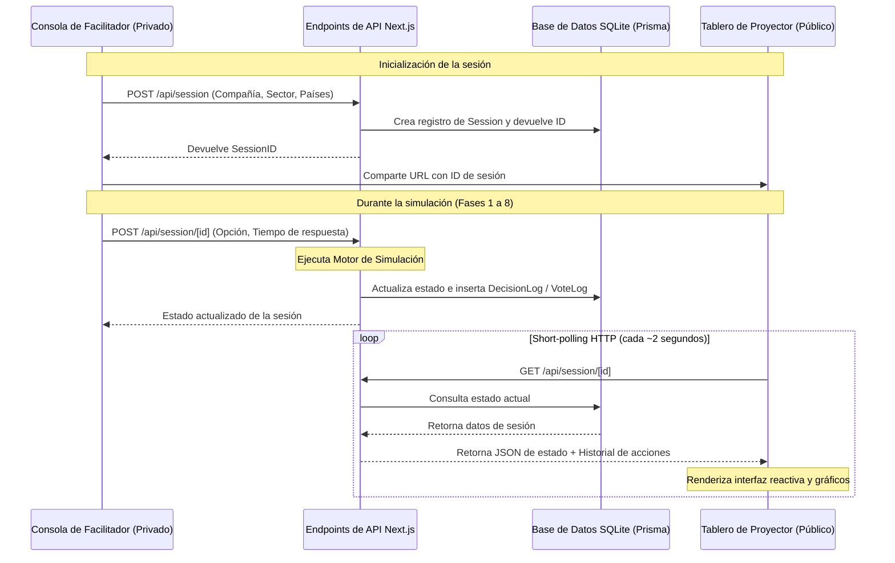

# Motor de Simulación CYBERTOP™ Premium - Guía de Funcionamiento

CYBERTOP™ es un simulador de crisis de ciberseguridad inmersivo de nivel corporativo para juntas directivas y comités C-suite. Este documento detalla la arquitectura del sistema, el motor matemático y regulatorio de 12 dimensiones, los algoritmos de simulación financiera y social, y la infraestructura de base de datos de la versión Premium (Fase 2).

---

## 1. Flujo del Sistema y Arquitectura de Sincronización

La versión Premium está construida como una aplicación full-stack moderna utilizando **Next.js (App Router)**, **Prisma ORM** y **SQLite**.

A diferencia del MVP inicial que utilizaba almacenamiento local del navegador (`LocalStorage`), la arquitectura Premium opera mediante sincronización centralizada en base de datos para habilitar visualizaciones en múltiples monitores independientes.



### Arquitectura de Base de Datos
El esquema relacional de la base de datos se almacena en `prisma/dev.db` y cuenta con las siguientes tablas:
*   **`Session`**: Estado principal de la sesión en curso (compañía, industria, multiplicadores regulatorios activos, paso actual, GCI, BRS, DVS y precio de la acción). Almacena los puntajes de las 12 dimensiones e historial de la acción en formato JSON.
*   **`DecisionLog`**: Historial detallado de las opciones de decisión elegidas por el board, incluyendo el tiempo tomado y su métrica DVS.
*   **`RedTeamLog`**: Bitácora de ataques del Red Team inyectados de sorpresa por el facilitador.
*   **`VoteLog`**: Registro individual de los votos del board para la toma de decisiones por consenso.
*   **`Benchmark`**: Base de datos histórica de 20 records simulados de competidores de la industria para el cálculo de percentil comparativo.

---

## 2. El Motor Matemático: Cálculo de Métricas (12 Dimensiones)

El núcleo de la simulación evalúa la preparación y el nivel de crisis a través de **12 dimensiones estratégicas**:

| Dimensión | Clave | Descripción |
| :--- | :---: | :--- |
| **Gobierno Global** | `GG` | Estructura de mando de crisis y capacidad fiduciaria. |
| **Coordinación Multi-jurisdicción** | `MC` | Gestión del incidente a través de filiales y fronteras. |
| **Velocidad de Decisión** | `VD` | Agilidad mental y operacional del comité ejecutivo. |
| **Cohesión C-suite** | `CC` | Alineación política y funcional de la alta gerencia. |
| **Gestión de Inversionistas** | `GI` | Mitigación del impacto reputacional ante accionistas de bolsa. |
| **Exposición Regulatoria** | `ER` | Nivel de cumplimiento y riesgo de sanciones de entes públicos. |
| **Gestión Reputacional** | `GR` | Relación con la prensa, control de rumores y redes sociales. |
| **Continuidad Global** | `CG` | Resiliencia operativa, redundancia de red y BCP. |
| **Terceros Internacionales** | `TI` | Exposición de seguridad en la cadena de suministros y vendors. |
| **Cultura de Riesgo** | `CR` | Madurez de ciberseguridad a nivel organizativo y de empleados. |
| **Resiliencia Financiera** | `RF` | Capacidad de absorber pérdidas de negocio y costes de seguro. |
| **Preparación de Junta** | `PJ` | Preparación fiduciaria y legal de los directores ante incidentes. |

### Pesos de Industria (Ponderaciones Relativas)
El motor multiplica los puntajes de las dimensiones según la industria seleccionada, sumando siempre un total de **$1.0$ (100%)**:

| Industria / Sector | GG | MC | VD | CC | GI | ER | GR | CG | TI | CR | RF | PJ |
| :--- | :---: | :---: | :---: | :---: | :---: | :---: | :---: | :---: | :---: | :---: | :---: | :---: |
| **Banca Internacional** (`BANCA`) | 10% | 10% | 5% | 5% | 10% | **15%** | 10% | 10% | 5% | 5% | 10% | 5% |
| **Salud y Farma** (`SALUD`) | 12% | 8% | 5% | 5% | 5% | **15%** | 10% | **15%** | 5% | 5% | 5% | 10% |
| **Tecnología, Cloud & SaaS** (`TECNOLOGIA`) | 8% | 10% | 8% | 7% | **12%** | 10% | **12%** | 10% | 10% | 5% | 5% | 3% |
| **Oil, Gas & Energía** (`OIL_GAS`) | 12% | 10% | 5% | 5% | 5% | 10% | 8% | **20%** | 8% | 5% | 7% | 5% |

---

## 3. Las Ecuaciones de la Crisis

### A. Global Crisis Index (GCI)
El **Global Crisis Index (GCI)** cuantifica en tiempo real la severidad de la crisis en un rango de **0 a 100**:

$$GCI = \text{clip}\left( \sum_{d \in \text{Dims}} (W_{\text{ind}, d} \times S_d) + P_{\text{total}} - M_{\text{total}}, \; 0, \; 100 \right)$$

Donde:
*   $S_d$ es el puntaje actual de la dimensión de riesgo $d$ ($0 \le S_d \le 100$).
*   $W_{\text{ind}, d}$ es el peso de la dimensión para el sector.
*   $P_{\text{total}}$ es la suma acumulada de las **Penalizaciones** por decisiones erróneas.
*   $M_{\text{total}}$ es la suma de las **Mitigaciones** ganadas por buenas decisiones.

### B. Board Readiness Score (BRS)
El **Board Readiness Score (BRS)** representa la capacidad de respuesta y madurez corporativa en una escala de **0.0 a 5.0**:

$$BRS = \text{clip}\left( 5.0 - \frac{GCI}{20}, \; 0.0, \; 5.0 \right)$$

Un índice de crisis de $0$ resulta en un BRS de $5.0$, mientras que un colapso del sistema ($GCI = 100$) reduce la preparación del Board a $0.0$.

### C. Decision Velocity Score (DVS)
El simulador evalúa la velocidad con la que la junta toma decisiones. Para cada decisión $j$:

$$DVS_j = \text{clip}\left( 100 \times \left(1 - \frac{t_j - SLA_j}{2 \times SLA_j}\right), \; 0, \; 100 \right)$$

Donde:
*   $t_j$ es el tiempo tomado en segundos por el board.
*   $SLA_j$ es el Acuerdo de Nivel de Servicio límite en segundos para la decisión actual.

#### Impactos en Dimensiones basados en el DVS:
*   **Toma de Decisiones Lentizada ($DVS_j < 60$)**: Aumenta el riesgo regulatorio y operativo. Se aplica un incremento de $+2$ a Exposición Regulatoria ($ER$) y $+1$ a Coordinación Multi-país ($MC$).
*   **Toma de Decisiones Eficiente ($DVS_j > 80$)**: Demuestra agilidad ejecutiva, aliviando la exposición en $-1$ a Exposición Regulatoria ($ER$) y $-1$ a Coordinación Multi-país ($MC$).
*   **Retraso Crítico (Supera el SLA)**: Si $t_j > SLA_j$, se activa un drift de incertidumbre que añade $+2$ a Gestión Reputacional ($GR$) y $+2$ a Velocidad de Decisión ($VD$).

---

## 4. Multiplicadores Regulatorios por Jurisdicción

Al inicializar la simulación, el facilitador puede activar diferentes reguladores. Estos aplican un multiplicador multiplicativo al incremento de riesgo sobre dimensiones específicas cuando ocurren inyecciones y decisiones:

*   **Europa (GDPR Audit)**: Multiplica los incrementos de **Exposición Regulatoria (`ER`)** y **Coordinación Multi-jurisdicción (`MC`)** por **$1.25$**.
*   **Estados Unidos (SEC Compliance)**: Multiplica los incrementos de **Exposición Regulatoria (`ER`)** y **Gestión de Inversionistas (`GI`)** por **$1.20$**.
*   **LATAM (Superintendencia)**: Multiplicador base neutral de **$1.0$**.

### Efectos Compuestos
Si tanto **Europa** como **EE.UU.** están activos simultáneamente, los multiplicadores se combinan. Por ejemplo, en Exposición Regulatoria (`ER`):

$$\text{Multiplicador}_{ER} = 1.25 \; (\text{EU}) \times 1.20 \; (\text{US}) = 1.50x$$

Cualquier incremento de riesgo en la dimensión `ER` aumentará un $50\%$ más rápido que el valor base en LATAM.

---

## 5. Simuladores Activos en Tiempo Real

### A. Algoritmo de Valoración Bursátil (Stock Price Drift)
El simulador de mercado calcula la cotización de las acciones de la compañía basándose en el estado de crisis, aplicando un modelo de **paseo aleatorio (random walk)** hacia un precio objetivo:

1.  **Cálculo de Caída Porcentual Máxima**:
    La caída acumulada de la acción se determina según el GCI y la presencia de eventos críticos:
    
    $$\text{dropPercent} = \text{clip}(GCI \times 0.065 + (\text{Penalidades} \times 1.5) - (\text{Mitigaciones} \times 0.8), \; 0, \; 30\%)$$
    
    La acción puede caer hasta un máximo de un $30\%$ respecto a su valor inicial de USD 100.
2.  **Precio Objetivo**:
    
    $$P_{\text{target}} = 100.0 \times \left(1 - \frac{\text{dropPercent}}{100}\right)$$
    
3.  **Generación de Ticks de Transición**:
    En lugar de realizar saltos secos de precio, el motor genera 5 ticks intermedios lineales para simular la fluctuación natural de la bolsa. Para cada tick intermedio, se añade un ruido de volatilidad aleatorio uniforme de entre **$-0.35\%$ y $+0.35\%$**:
    
    $$P_{\text{tick}} = P_{\text{interpolado}} + \text{Uniform}(-0.35, \; 0.35)$$

### B. Monitoreo de Redes Sociales (Step-Locked Twitter Feed)
El tablero del proyector incluye un simulador de opiniones públicas en redes sociales. 
*   A medida que el facilitador avanza de la Fase 1 a la 8, se desbloquean e insertan dinámicamente tweets en el panel de medios.
*   Los contenidos de las reacciones están pre-configurados para coincidir de forma precisa con el sector de la simulación seleccionado, representando comentarios de analistas de seguridad, reguladores locales, periodistas y pánico de clientes.

---

## 6. Percentil Comparativo (Benchmark Engine)

Al finalizar las 8 fases del wargame, la aplicación evalúa el rendimiento general de la junta comparándola con otras organizaciones del sector.

La base de datos contiene registros pre-sembrados con puntuaciones reales de 20 competidores simulados. El percentil representa la proporción de competidores que obtuvieron un **GCI más alto** (peor desempeño) que la junta actual:

$$\text{Percentile} = \text{round}\left( \frac{\text{Peers con } GCI_{\text{peer}} > GCI_{\text{sesión}}}{\text{Total de Peers en la misma industria}} \times 100 \right)$$

*   *Ejemplo*: Si la junta termina con un GCI de $30.0$, y de los 5 peers históricos de Banca, 4 tuvieron un GCI superior a $30.0$, el percentil resultante es **$80\%$**. Esto indica que la junta directiva superó al $80\%$ de sus competidores en la gestión de la crisis fiduciaria.

---

## 7. Comandos de Instalación, Configuración y Pruebas

Para inicializar y ejecutar el simulador localmente, siga los siguientes pasos de desarrollo y operación.

### Requisitos Previos
Asegúrese de contar con **Node.js (versión 18 o superior)** y **npm** instalados.

### 1. Instalación de Dependencias
Acceda al directorio de la aplicación premium e instale los paquetes requeridos:
```bash
cd cybertop-premium
npm install
```

### 2. Configuración y Migración de Base de Datos (Prisma & SQLite)
Sincronice el esquema del modelo con SQLite y ejecute el script de siembra para poblar los peers de benchmarking:
```bash
# Crear la base de datos local y tablas
npx prisma db push

# Poblar benchmarks de competidores en dev.db
npx prisma db seed
```

### 3. Ejecución en Modo Desarrollo
Inicie el servidor local de Next.js. El sitio estará disponible en [http://localhost:3000](http://localhost:3000).
```bash
npm run dev
```

### 4. Pruebas Unitarias del Motor y Base de Datos
La aplicación cuenta con dos entornos de pruebas independientes y automatizados para validar que las fórmulas matemáticas y los accesos a base de datos funcionen de forma óptima:
```bash
# Validar motor de 12 dimensiones, multiplicadores y cálculo BRS/GCI
node test_premium_engine.mjs

# Validar conexiones Prisma y lógica de percentil de base de datos
node test_db.mjs
```

### 5. Compilación y Despliegue en Producción
Para compilar y empaquetar la aplicación de forma optimizada:
```bash
# Compilar producción
npm run build

# Iniciar servidor de producción compilado
npm run start
```
