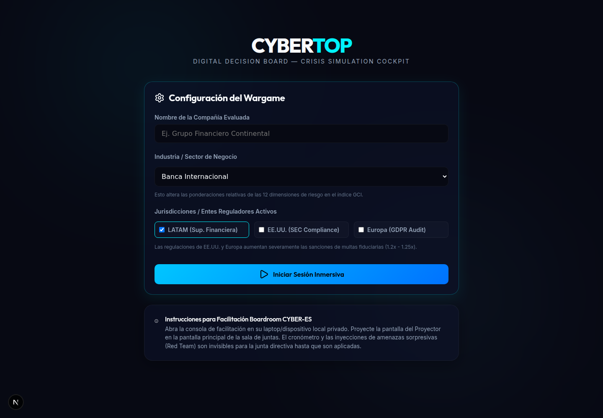
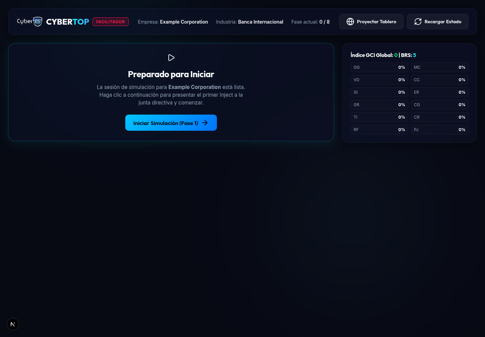
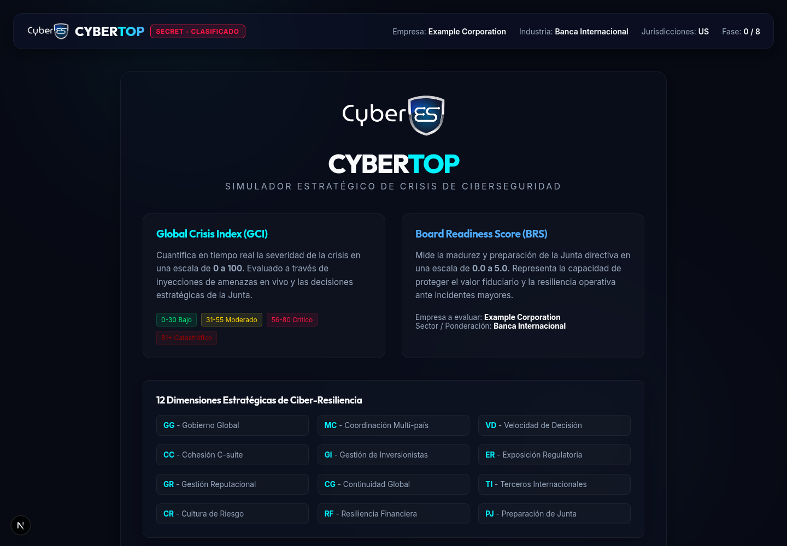

# CYBERTOPS

CYBERTOP Premium is a cybersecurity crisis simulation for executive teams and boards. A facilitator runs a scenario while a separate projector dashboard displays the evolving crisis, decisions, and metrics. The interface and detailed simulation documentation are primarily in Spanish.

Learn more at [cyber-es.com](https://www.cyber-es.com/).

## Screenshots

**Session setup**



**Facilitator console** — a sample session ready to begin.



**Projector dashboard** — the shared view for participants.



## Requirements

- Node.js 20.9 or later and npm
- A writable local filesystem for the SQLite database

## Getting started

```bash
npm install
npx prisma generate
npx prisma db push
npm run dev
```

Open [http://localhost:3000](http://localhost:3000), enter the company and scenario details, and create a session. The app opens the facilitator console with a session ID in the URL. Use **Proyectar Tablero** to open the projector view for that same session; share that view on a second display. The facilitator starts and advances the simulation from the console. Both views require a session ID, so opening `/facilitator` or `/projector` directly without one will show an error.

The Prisma schema uses `prisma/dev.db`. A database is included in the repository; `prisma db push` synchronizes its schema. To populate benchmark data, run `node prisma/seed.js`. **The seed deletes existing benchmark records** before inserting its sample data.

## Commands

| Command | Purpose |
| --- | --- |
| `npm run dev` | Start the development server |
| `npm run build` | Build for production |
| `npm start` | Start the production server after building |
| `npm run lint` | Run ESLint |
| `node test_premium_engine.mjs` | Run the standalone simulation engine checks |

## How it works

The Next.js application exposes facilitator and projector views and API routes for sessions and votes. Prisma stores sessions, decisions, votes, red-team events, and benchmarks in SQLite. The simulation engine evaluates decisions across 12 risk dimensions and calculates crisis, readiness, and decision-speed metrics. The projector periodically polls the session API for updates.

- `src/app/` — pages, styles, and session API routes.
- `src/components/` — facilitator and projector interfaces.
- `src/lib/` — simulation configuration, engine, benchmarks, and Prisma client.
- `prisma/` — schema, SQLite database, and benchmark seed.
- `public/` — static assets.
- `Recursos/` — supporting documents and media; see its README.
- `scratch/` and root `test_*.mjs` / `check_*.mjs` — standalone development and diagnostic scripts; some require a running server or database.
- `HOW_IT_WORKS.md` — detailed Spanish documentation of the architecture, simulation, and metrics.

## Technology

Next.js App Router, React, Prisma and SQLite, Tailwind CSS, Recharts, and Lucide icons.
